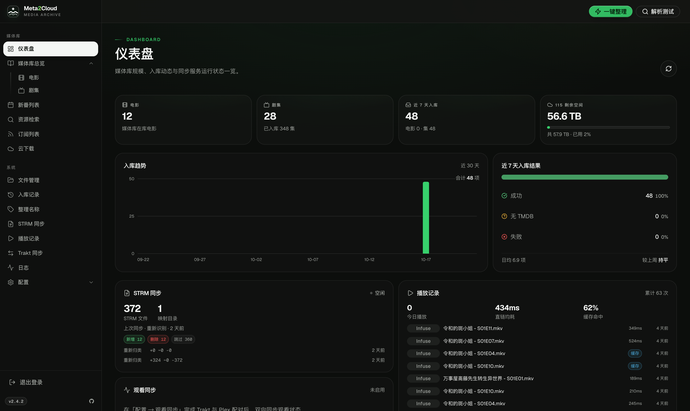
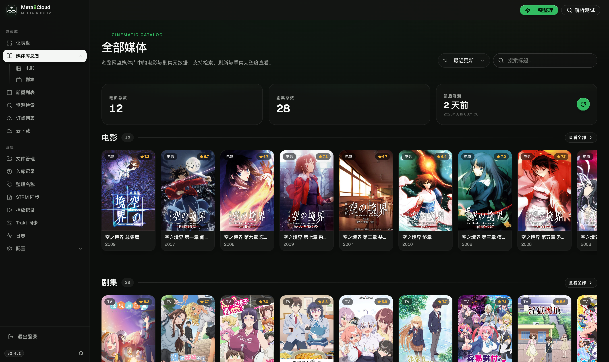
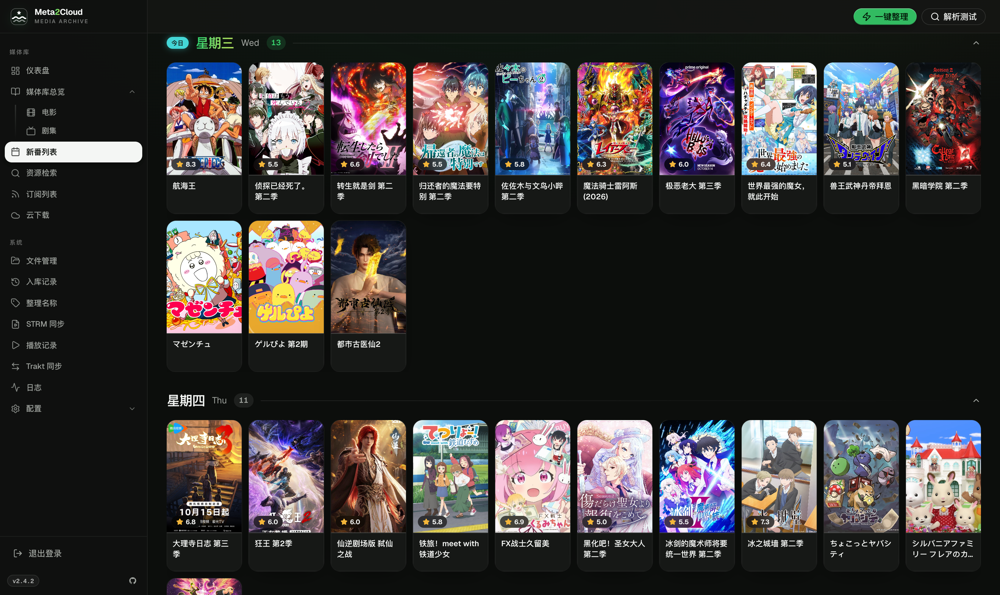
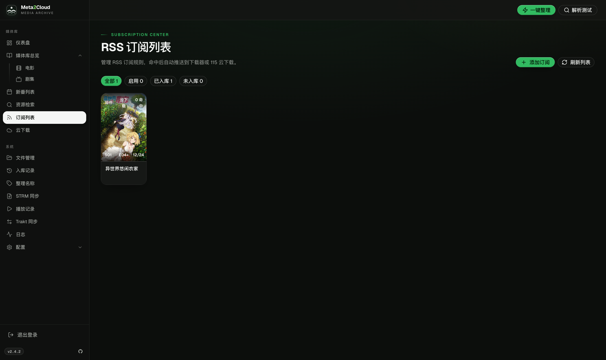
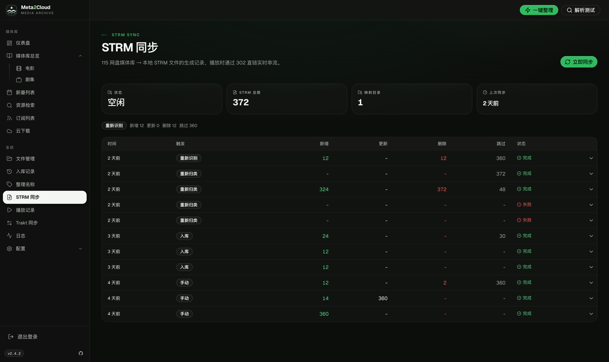

# Meta2Cloud

115 网盘一站式影音管理平台 —— 找片、订阅、云下载、自动整理、直链播放、观看同步，一个面板全搞定。

  

## 为什么用这个？

**网盘就是你的媒体库，无需媒体服务器也能有刮削好的观影体验。**

如果你：
- 用 115 网盘存电影和剧集，用 Infuse、爆米花等播放器直连观看
- 或者想用 Emby/Jellyfin，却不想把网盘文件搬回本地
- 追新番，厌倦了手动找资源、传网盘、改文件名

那 Meta2Cloud 可以帮你打通整条链路：

```
新番日历 / 资源检索
  ↓ 订阅
RSS 自动追番
  ↓ 推送
115 云下载（离线任务）
  ↓ 下载完成
自动整理（识别文件名 → TMDB 中文译名 → 规范目录）
  ↓
媒体库 / STRM 直链
  · Infuse、爆米花直连网盘观看
  · Emby / Jellyfin 挂载 STRM（302 直链，本地零占用）
  · Plex ↔ Trakt 观看状态双向同步
```

## 功能

**找片与下载**
- 📺 **新番日历** — Bangumi 每周放送表，一键跳转资源检索
- 🔎 **资源检索** — 聚合 Mikan / AniBT，按字幕组分组的搜索结果
- 📡 **RSS 订阅** — 自动追新番，新集自动推送 115 云下载
- ☁️ **115 云下载** — 离线任务管理：添加链接、进度、配额、自动整理开关

**自动整理**
- 📝 **智能识别** — 文件名解析片名、年份、季集号；中文数字、拼音、民间译名都能识别，解析测试随时验证
- 🔍 **TMDB 匹配** — 获取中文译名与元数据；译名钉扎防目录分叉，识别错了可重新识别纠错
- 🗂 **规范目录** — 整理为 `标题 (年份)/Season NN` 并重命名，外挂字幕自动跟随；支持自定义两级媒体分类目录树
- ⏱ **多种触发** — 115 云下载完成自动整理、webhook 触发（防抖合并批量）、WebUI 一键整理

**播放与同步**
- 🎬 **STRM 直链播放** — 生成本地 `.strm` 镜像网盘目录，播放时 302 直连 115，不占本地空间，接入 Emby/Jellyfin 即可观看
- 📊 **播放记录** — 每次播放的客户端、直链延迟与结果
- 🔄 **观看同步** — Plex ↔ Trakt 双向同步，SSE 实时推送播放进度

**管理与通知**
- 📁 **网盘文件管理** — 浏览、搜索、重命名、移动、批量操作
- 📚 **媒体库总览** — 电影/剧集海报墙、详情、收录进度，入库记录可溯
- 📈 **仪表盘与日志** — 库存统计、实时滚动日志
- 📲 **Telegram 通知** — 整理与 STRM 合并成一条富通知

## 整理效果

**整理前：**
```
/下载/
  ├── [字幕组]Breaking.Bad.S01E03.1080p.BluRay.x264.mkv
  ├── 绝命毒师.第一季第4集.mp4
  └── inception.2010.1080p.bluray.mkv
```

**整理后：**
```
/媒体库/
  ├── 绝命毒师 (2008)/
  │   └── Season 01/
  │       ├── 绝命毒师 - S01E03.mkv
  │       ├── 绝命毒师 - S01E03.zh-CN.srt
  │       └── ...
  └── 盗梦空间 (2010)/
      └── 盗梦空间 (2010).mkv
```

## 快速开始

### Docker 部署（推荐）

**1. 启动容器**

创建 `docker-compose.yml`：

```yaml
services:
  meta2cloud:
    image: benz1/meta2cloud:latest
    container_name: meta2cloud
    # 以 UID/GID 运行（默认 1000:1000，与媒体服务器 PUID/PGID=1000 一致，
    # 使其可删除/重命名生成的 STRM 文件；如需修改在 .env 中设置 PUID/PGID）
    user: "${PUID:-1000}:${PGID:-1000}"
    environment:
      - TZ=Asia/Shanghai
    volumes:
      - ./meta2cloud-config:/app/config
      # 启用 STRM 直链播放：取消注释
      # 注意：WebUI 里 STRM 输出目录必须填容器内路径（如 /media/strm）
      # - ./strm:/media/strm
    network_mode: host
    restart: unless-stopped
```

```bash
# 首次部署或从 root 运行的旧版本升级时需要：保证挂载目录可被 UID 1000 写入
mkdir -p meta2cloud-config && chown -R 1000:1000 meta2cloud-config
docker compose up -d
```

首次启动会自动生成默认配置，**无需提前编辑任何文件**。

**2. 获取初始密码**

```bash
docker logs meta2cloud | grep 初始密码
```

**3. 打开 `http://localhost:38765` 完成初始化**

1. 用初始密码登录（用户名 `admin`），登录后在配置页修改密码
2. 在配置页**扫码授权 115**（内置默认应用，开箱即扫；也可填自己的 client_id）
3. 填入 [TMDB API Key](https://www.themoviedb.org/settings/api)（免费申请）
4. 用目录选择器直选网盘目录：下载目录、媒体库目录
5. 开启「云下载自动整理」，之后离线下载完成的文件会自动整理入库

> 所有配置都在 Web UI 完成，配置文件仅作持久化。不用 Docker？在 [Releases](https://github.com/BenZinaDaze/Meta2Cloud/releases) 下载二进制运行 `./meta2cloud serve` 即可，配置目录为工作目录下的 `config/`。

## Web UI 截图

| 仪表盘 | 媒体库总览 |
|---|---|
|  |  |
| **新番列表** | **订阅列表** |
|  |  |
| **115 云下载** | **STRM 同步** |
|  |  |

## 配置说明

所有配置均可在 Web UI「配置」页修改，配置项详解见 [config/config.example.yaml](config/config.example.yaml)。常用的几项：

| 配置 | 说明 | 在哪配 |
|------|------|--------|
| Web UI 密码 | 登录凭证，首启随机生成 | 首启日志 / 配置页 |
| TMDB API Key | 元数据来源，必填 | 配置页 |
| 115 授权 | 扫码授权，token 自动续期 | 配置页 |
| 下载 / 媒体库目录 | 整理的源与目标 | 配置页（目录选择器直选） |
| 媒体分类 | 自定义电影/剧集两级目录树 | 分类配置页 |
| 识别规则 | 自定义识别词、发布组 | 识别规则页 |

## 推荐播放器

这些播放器可以直接连接 115 网盘，按规范目录名自行刮削元数据：

| 播放器 | 平台 | 支持网盘 | 特点 |
|--------|------|----------|------|
| [Infuse](https://firecore.com/infuse) | iOS / macOS / Apple TV | 115 | Apple 生态体验最佳 |
| [网易爆米花](https://bmh.163.com/) | 全平台 | 115、阿里云盘 | 对国内网盘支持好 |
| [VidHub](https://vidhub.okaapps.com/) | 全平台 | 115 等 | 免费、跨平台 |
| [nPlayer](https://nplayer.com/) | iOS / macOS / Android | 115 等 | 功能全面 |

已有 Emby/Jellyfin？启用 [STRM 直链播放](#strm-直链播放)，媒体库不占本地空间。

## 高级功能

### STRM 直链播放

为网盘媒体库生成本地 `.strm` 文件（目录结构镜像网盘，外挂字幕自动跟随下载），播放时由 Meta2Cloud 实时 302 跳转 115 直链——原画直连播放，本地零占用。

```yaml
strm:
  enabled: true
  url_base: "http://192.168.1.10:38765"   # 播放器能访问到 Meta2Cloud 的地址，支持域名/反代
  url_secret: ""                           # 可选，防未授权调用；配置页可一键随机生成
  mappings:
    - pan_folder_id: "媒体库根目录 ID"      # 网盘目录
      local_path: "/media/strm"            # 本地输出目录（Docker 中须为容器内路径）
```

- **触发**：整理入库成功后自动生成 + 定时增量同步 + WebUI「STRM 同步」页手动触发
- **限流**：直链获取并发上限 + 失败负缓存 + 排队超时，媒体服务器刮削扫描不影响正常播放
- **播放记录**页可查看每次播放的客户端、直链延迟与结果

将 STRM 输出目录加入 Emby/Jellyfin 媒体库即可播放。Docker 部署记得在 compose 中挂载该目录，且 `local_path` 填容器内路径。

### 观看同步（Plex ↔ Trakt）

将 STRM 媒体库接入 Plex 后，可与 Trakt 双向同步观看状态：

- **Trakt → Plex**：Trakt 已看记录同步到 Plex 标记已看
- **Plex → Trakt**：Plex 已看 / 播放进度 ≥80% 自动记录到 Trakt，SSE 实时推送
- 首次同步合并两侧已看记录（并集），之后按增量双向同步；冲突时以 Trakt 为准
- 全部在 Web UI「Trakt 同步」页完成：Trakt 授权、Plex 配对、同步方向与选项

### 自动触发整理

外部下载工具完成后可 webhook 触发整理（密钥首次启动自动生成，可在 `config/secrets.yaml` 的 `webui.webhook_secret` 查看）：

```bash
curl -X POST http://localhost:38765/trigger \
  -H "Content-Type: application/json" \
  -H "X-Webhook-Secret: 你的密钥"
```

支持防抖，批量下载合并为一次整理。

### Telegram 通知

整理完成自动推送，整理与 STRM 合并为一条富通知：

```yaml
telegram:
  bot_token: "从 @BotFather 获取"
  chat_id: "你的 Chat ID"
```

## 常见问题

**会删除原文件吗？**

整理是"移动"到目标目录，不是删除（移除的同名文件可在网盘回收站恢复）。

**文件名识别错误怎么办？**

用 Web UI 的"解析测试"验证识别结果，识别规则页可添加自定义识别词；已入库的媒体可在详情页重新识别纠错。

**TMDB 找不到怎么办？**

通常是文件名太乱或别名太多，可在识别规则页添加别名后重新整理。

**115 接口频繁 429？**

115 开放平台 QPS 限制为 3，Meta2Cloud 已内置限流与风控冷却。避免与其他 115 脚本共用同一账号密集调用。

## 从 v1 升级

v2 起 Meta2Cloud 使用 Go 全面重构：单二进制部署、镜像更小、启动更快、内存占用更低。SQLite 表结构与 v1 一致，现有 `library.db` 和 115 授权 token 可直接沿用，**升级无需迁移**，替换镜像即可。各版本变更见 [CHANGELOG.md](CHANGELOG.md)。

> v2.0.0 起仅支持 115 网盘。仍需 Google Drive 的用户请使用 [v1.3.1](https://github.com/BenZinaDaze/Meta2Cloud/releases/tag/v1.3.1)，配合仓库中的 [`docker-compose.gdrive.yml`](docker-compose.gdrive.yml) 部署。注意 v1.3.1 与 v2 不建议同时挂载同一数据目录。

## 开发

```bash
# 构建
go build -o meta2cloud ./cmd/meta2cloud

# 启动 Web 服务（所有功能都通过 WebUI / WebAPI 使用）
go run ./cmd/meta2cloud serve

# 后端测试
go test ./internal/... -count=1

# 一键启动开发环境（Go 后端 + Vite 前端热更新）
./scripts/dev.sh
```

架构说明见 [CLAUDE.md](CLAUDE.md)；115 接口与云存储/资源站点接入指南见 [doc/](doc/)。

## 致谢

识别词部分参考 [MoviePilot](https://github.com/jxxghp/MoviePilot) 项目。

## 许可证

[GPL v3](LICENSE)
