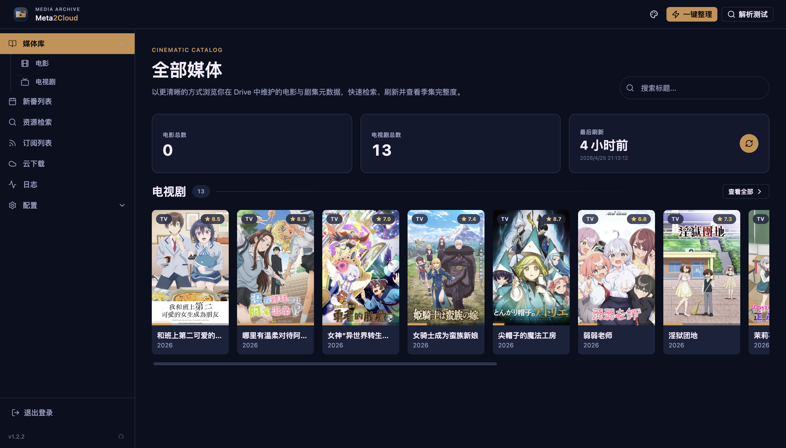
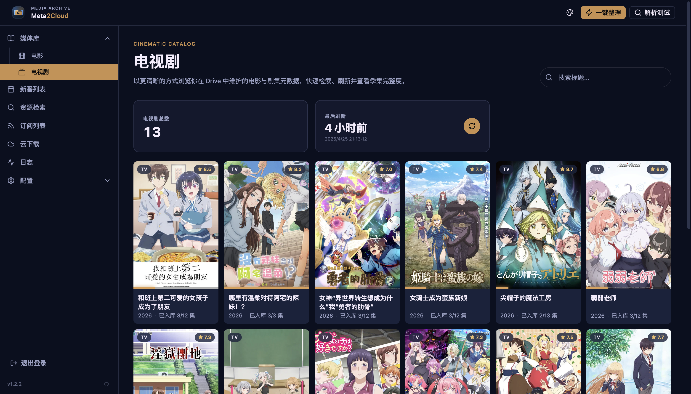
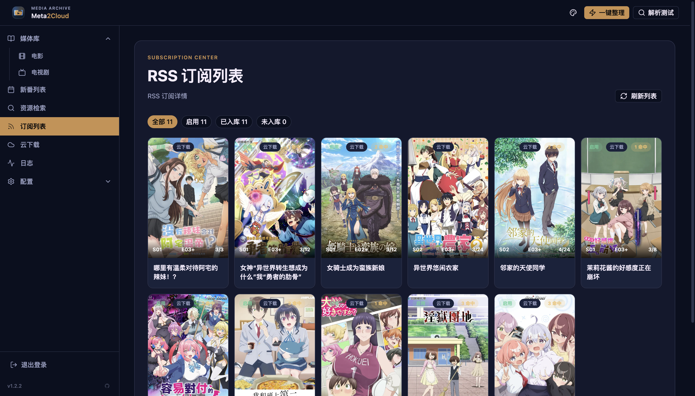
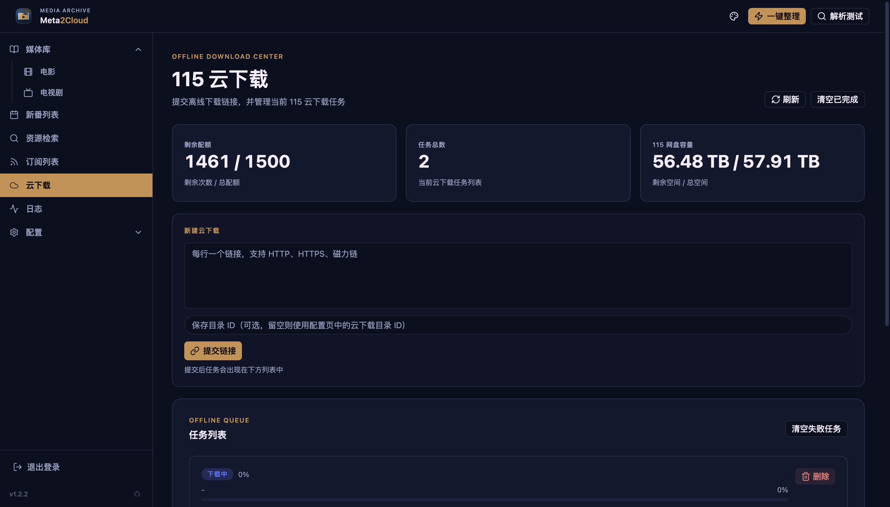
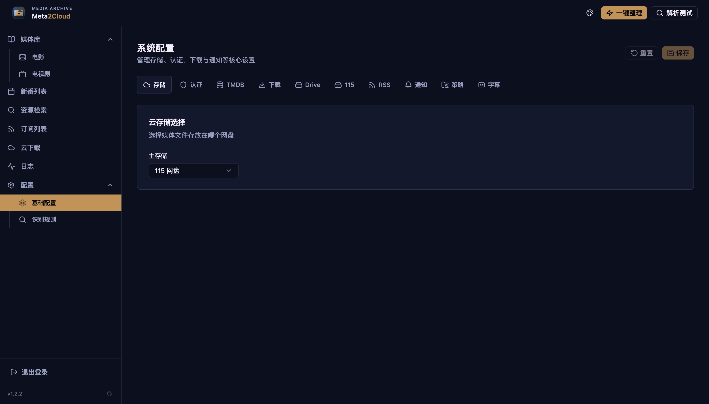

# Meta2Cloud

网盘媒体库自动整理工具，配合 Infuse、爆米花等播放器使用。

      

## 为什么用这个？

**无需媒体服务器，也能有刮削好的媒体库体验。**

如果你：
- 用网盘存电影和剧集
- 不想搭建 Plex/Emby/Jellyfin 服务器
- 用 Infuse、爆米花等播放器直连网盘观看

那 Meta2Cloud 可以帮你：
- 自动识别文件名，按 TMDB 中文译名整理成规范的目录结构并重命名
- Infuse/爆米花直连网盘后自行刮削，直接展示海报、简介、演员信息

## 推荐播放器

这些播放器可以直接连接网盘，按规范目录名自行刮削元数据：

| 播放器 | 平台 | 支持网盘 | 特点 |
|--------|------|----------|------|
| [Infuse](https://firecore.com/infuse) | iOS / macOS / Apple TV | 115 | Apple 生态体验最佳 |
| [网易爆米花](https://bmh.163.com/) | 全平台 | 115、阿里云盘 | 对国内网盘支持好 |
| [VidHub](https://vidhub.okaapps.com/) | 全平台 | 115 等 | 免费、跨平台 |
| [nPlayer](https://nplayer.com/) | iOS / macOS / Android | 115 等 | 功能全面 |

## 功能

- 📝 **解析文件名** — 自动识别片名、年份、季集号
- 🔍 **查询 TMDB** — 获取中文片名、简介、评分
- 📁 **整理目录** — 符合播放器识别规范
- 🔄 **移动文件** — 按标准格式自动重命名
- 📝 **字幕整理** — 自动跟随视频移动
- 🎬 **STRM 直链播放** — 生成本地 STRM 文件（外挂字幕自动跟随），播放时 302 直连网盘，无需下载
- 📊 **播放记录** — 记录每次播放的客户端、直链耗时与结果
- 📲 **Telegram 通知** — 整理完成推送

## 整理效果

**整理前：**
```
/下载/
  ├── [字幕组]Breaking.Bad.S01E03.1080p.BluRay.x264.mkv
  ├── 绝命毒师.第一季第4集.mp4
  └── inception.2010.1080p.bluray.mkv
```

**整理后：**
```
/媒体库/
  ├── 绝命毒师 (2008)/
  │   └── Season 01/
  │       ├── 绝命毒师 - S01E03.mkv
  │       ├── 绝命毒师 - S01E03.zh-CN.srt
  │       └── ...
  └── 盗梦空间 (2010)/
      └── 盗梦空间 (2010).mkv
```

## 支持的网盘

- 115 网盘

## v2.0.0 更新内容

后端使用 **Go 全面重构**（原 Python/FastAPI 实现）：

- **单二进制部署** — 约 20MB 静态编译，Docker 镜像更小、启动更快、内存占用更低
- **数据完全兼容** — SQLite 表结构与 v1 一致，现有 `library.db`、115 授权 token 可直接沿用，升级无需迁移
- **115 限流与重试** — 请求管线内置 QPS 预约、风控冷却与指数退避，大批量整理更稳
- **识别增强** — TMDB 模糊搜索唯一候选回退（民间译名可识别）、新番集数增长自适应、同剧多目录集数聚合
- **移除 Google Drive 支持** — 聚焦 115 网盘（需要 Google Drive 的用户请继续使用 [v1.3.1](#google-drive-用户)，见下方说明）
- RSS 订阅站点（Mikan、AniBT）与 v1 保持一致

各版本完整更新日志见 [CHANGELOG.md](CHANGELOG.md)。

升级：直接替换二进制或拉取新镜像即可。

## Google Drive 用户

v2.0.0 起仅支持 115 网盘。仍需 Google Drive 的用户请使用最后一个支持它的版本
**v1.3.1**，仓库提供了 [`docker-compose.gdrive.yml`](docker-compose.gdrive.yml)：

```bash
# 凭据文件放入挂载目录（容器内 /app/config）
mkdir -p meta2cloud-config
cp config.example 的配置同 v1   # 见 v1.3.1 的 config/config.example.yaml
# 将 credentials.json / token.json 放入 meta2cloud-config/

docker compose -f docker-compose.gdrive.yml up -d
```

注意：v1.3.1 与 v2.0.0 的 `library.db` 结构兼容，但不建议两个版本同时挂载同一数据目录。

## 快速开始

### Docker 部署（推荐）

```bash
# 创建配置目录
mkdir -p meta2cloud-config

# 复制配置文件模板
cp config/config.example.yaml meta2cloud-config/config.yaml
cp config/parser-rules.example.yaml meta2cloud-config/parser-rules.yaml
```

创建 `docker-compose.yml`：

```yaml
services:
  meta2cloud:
    image: benz1/meta2cloud:latest
    container_name: meta2cloud
    environment:
      - TZ=Asia/Shanghai
    volumes:
      - ./meta2cloud-config:/app/config
      # 启用 STRM 直链播放：取消注释，local_path 填容器内路径 /media/strm
      # - ./strm:/media/strm
    network_mode: host
    restart: unless-stopped
```

启动：

```bash
docker compose up -d
```

访问 `http://localhost:38765` 打开 Web UI。

### 本地运行

后端：
```bash
go build -o meta2cloud ./cmd/meta2cloud
./meta2cloud serve --port 38765
```

前端开发（可选）：
```bash
cd frontend
npm install
npm run dev   # http://localhost:5173，自动代理 API 到后端
```

直接运行整理（无需启动 Web UI）：
```bash
./meta2cloud pipeline            # 正式整理
```

## Web UI 截图








## 配置说明

详细配置说明见 [config/config.example.yaml](config/config.example.yaml)。

除必填配置外，其他配置可在 Web UI 中配置。

### 必填配置

```yaml
# 使用哪个网盘
storage:
  primary: "pan115"

# Web UI 登录
webui:
  username: "admin"
  password: "你的密码"

# TMDB API（从 https://www.themoviedb.org/settings/api 获取）
tmdb:
  api_key: "你的 TMDB API Key"
  language: "zh-CN"
  image_base_url: ""  # 可选；仅填根域名，留空默认 https://image.tmdb.org
```

### 115 网盘配置

```yaml
storage:
  primary: "pan115"

u115:
  client_id: "你的 client_id"   # 从 115 开放平台获取，必填
  download_folder_id: "云下载目录 ID"
  root_folder_id: "媒体库根目录 ID"
  movie_root_id: "电影目录 ID"  # 可选
  tv_root_id: "剧集目录 ID"     # 可选
```

目录 ID 从浏览器地址栏的 `cid` 参数获取。

首次使用时，通过 Web UI 扫码授权。

## 高级功能

### 自动触发整理

下载完成后自动触发整理，配合 rclone 使用：

```bash
curl -X POST http://localhost:38765/trigger \
  -H "Content-Type: application/json" \
  -H "X-Webhook-Secret: 你的密钥"
```

支持防抖，批量下载时合并为一次整理。

### STRM 直链播放

为网盘媒体库生成本地 `.strm` 文件（目录结构镜像网盘，外挂字幕自动跟随下载），播放时由 Meta2Cloud 实时 302 跳转 115 直链——媒体库不占本地空间，原画直连播放。

```yaml
strm:
  enabled: true
  url_base: "http://192.168.1.10:38765"   # 播放器能访问到 Meta2Cloud 的地址，支持域名/反代
  url_secret: ""                           # 可选，防未授权调用；配置页可一键随机生成
  mappings:
    - pan_folder_id: "媒体库根目录 ID"      # 网盘目录
      local_path: "/media/strm"            # 本地输出目录（Docker 中须为容器内路径）
```

- **触发**：整理入库成功后自动生成 + 定时增量同步 + WebUI「STRM 同步」页手动触发
- **播放**：`.strm` 内容指向 `/strm/redirect`，按播放器 User-Agent 换取 115 直链并缓存（过期前 5 分钟刷新）
- **限流**：直链获取并发上限 + 失败负缓存 + 排队超时，媒体服务器刮削扫描不影响正常播放
- **播放记录**页可查看每次播放的客户端、直链耗时与结果

将 STRM 输出目录加入 Emby/Jellyfin 媒体库即可播放。Docker 部署记得在 compose 中挂载该目录（见 `docker-compose.yml` 注释），且 `local_path` 填容器内路径。

### Telegram 通知

整理完成自动推送通知：

```yaml
telegram:
  bot_token: "从 @BotFather 获取"
  chat_id: "你的 Chat ID"
```

### RSS 订阅

支持 Mikan Project、AniBT 动漫订阅，自动追新番（推送至 115 云下载）。

## 常见问题

**会删除原文件吗？**

整理是"移动"到目标目录，不是删除（移除的同名文件可在网盘回收站恢复）。

**文件名识别错误怎么办？**

用 Web UI 的"解析测试"查看识别结果，可以在 `parser-rules.yaml` 中添加自定义识别词。

**TMDB 找不到怎么办？**

通常是文件名太乱或别名太多。尝试修改文件名后重新整理。

## 开发

```bash
# 后端测试
go test ./internal/... -count=1

# 一键启动开发环境（Go 后端 + Vite 前端热更新）
./scripts/dev.sh

# 前端
cd frontend && npm run build
```

架构说明见 [CLAUDE.md](CLAUDE.md)；云存储/资源站点接入指南见 [doc/](doc/)。

## 致谢

识别词部分参考 [MoviePilot](https://github.com/jxxghp/MoviePilot) 项目。

## 许可证

[GPL v3](LICENSE)
